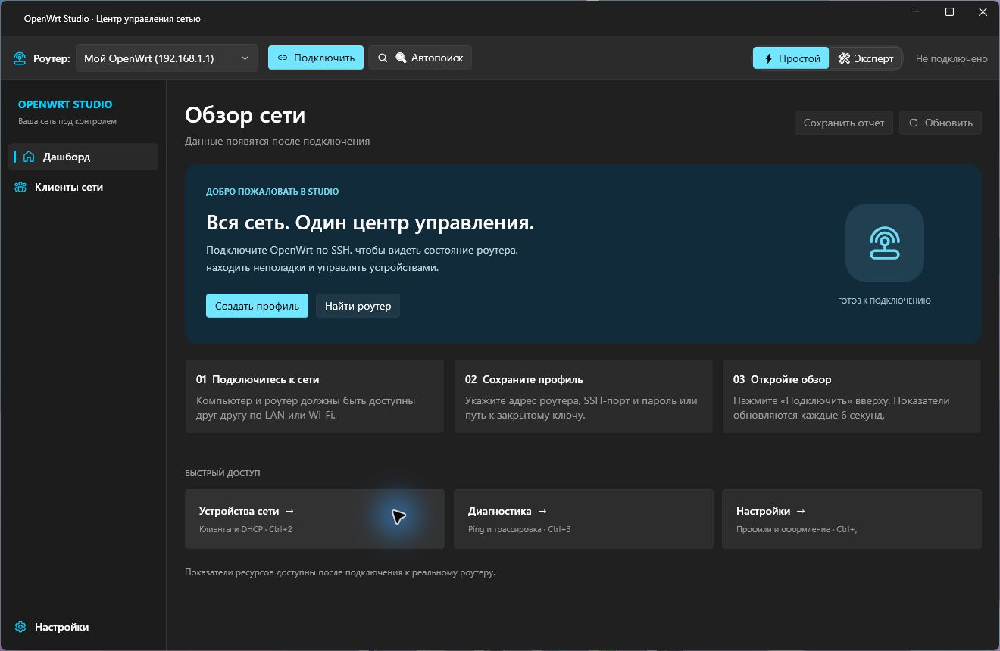

<div align="center">

# 🌐 OpenWrt Studio (WrtPilot) v2.5.19

**Современный центр управления, глубокой настройки, мониторинга и автоматического устранения неполадок для роутеров OpenWrt.**

[](https://github.com/RichkovGit/OpenWrtStudio/releases/tag/v2.5.19)
[](https://github.com/RichkovGit/OpenWrtStudio/releases)
[](https://dotnet.microsoft.com/)
[](https://openwrt.org/)
[](LICENSE)

[📦 Скачать Portable (.zip)](#-загрузка-и-установка) • [📝 Изменения v2.5.19](RELEASE_NOTES.md) • [🚀 Возможности](#-ключевые-возможности) • [🛠️ Сборка из исходников](#-сборка-из-исходников)

</div>

---

## 📖 О проекте

**OpenWrt Studio** — это автономное настольное Windows-приложение, созданное на стыке высоких технологий и максимального удобства («всё для людей»). Программа заменяет десятки разрозненных веб-страниц LuCI и терминальных команд единым, быстрым и красивым Fluent Design интерфейсом.

Приложение позволяет настраивать Wi-Fi, интернет-соединения, правила брандмауэра, маршруты обхода блокировок, настраивать современные протоколы (AmneziaWG, Sing-box, Mihomo, WireGuard, Tailscale), внедрять подписки и автоматически восстанавливать доступ в интернет при сбоях.

Доступность отдельных функций зависит от прошивки, архитектуры и установленных на роутере пакетов. Для работы нужны доступ по SSH и права на соответствующие настройки.

---


## 📸 Скриншоты десктопного интерфейса



В v2.5.19 добавлены стартовый экран подключения, время последнего снимка и сохранение текстового отчёта без профилей, IP/MAC-адресов, паролей и ключей. Горячие клавиши: `Ctrl+1` — обзор, `Ctrl+2` — клиенты, `Ctrl+3` — диагностика, `Ctrl+,` — настройки. Полный список исправлений — в [заметках о выпуске](RELEASE_NOTES.md).

---

## 🚀 Ключевые возможности

### 1. 🔔 Фоновый мониторинг и Уведомления Windows
* **Фоновое слежение**: Программа непрерывно опрашивает роутер в фоновом режиме (каждые 25 секунд).
* **Нативные уведомления (Toast Notifications)**:
  * ⚠️ Оповещение при обрыве SSH/связи с роутером и автоматическое уведомление при её восстановлении.
  * 🚨 Предупреждения при критической перегрузке памяти (RAM > 92%) или заполнении диска (`/overlay` > 92%).
  * 🩺 Оповещения сторожевого пса (сбои DNS, обрыв PPPoE, потеря несущей на порту WAN).
* **Системный трей Windows (System Tray)**:
  * Отображение живого статуса роутера в тултипе трея (`В сети: RAM 28%`).
  * Меню быстрого доступа: *Открыть Studio*, *Перезапустить сеть*, *Очистить кэш DNS*, *Выход*.
  * При закрытии окна крестиком «X» приложение сворачивается в трей и продолжает мониторить роутер.

### 2. 🌐 Конструктор Mihomo (Clash.Meta) + Внедрение подписок
* **Вкладка «Подписки»**: вставка ссылок на подписки в совместимом с Mihomo формате.
* **Инжекция в конфигуратор**: автоматическое создание блоков `proxy-providers` и привязка к группам прокси (`use: [имя-подписки]`).
* **Прямое обновление на роутере**: скачивание свежих узлов через `curl/wget` прямо в `/etc/mihomo/proxy_providers/` и перезагрузка службы без перезагрузки всей системы.
* **Готовые пресеты в 1 клик**:
  * ⚡ **«Умный обход (Антизапрет + RU напрямую)»**: сайты РФ и банки идут на полной скорости провайдера, а заблокированные ресурсы и YouTube/Discord направляются через прокси.
  * 🌐 **«Полный туннель»**: весь внешний трафик направляется через VPN.

### 3. ⚡ Репозиторий ForkOP и глубокая диагностика
* **Автоопределение архитектуры**: определение процессора роутера (`mips_24kc`, `aarch64_cortex-a53`, `x86_64`) и версии OpenWrt для генерации оптимизированных фидов ForkOP в `/etc/opkg/customfeeds.conf`.
* **Установка компонентов в 1 клик**: PassWall 2, SmartDNS, ChinaDNS-NG, MosDNS, Sing-box Core, Xray Core.
* **Глубокая диагностика**:
  * Анализ таблиц `nftables` (`table inet fw4`) и `iptables`.
  * Проверка перехвата DNS на порты анти-DPI резолверов (5335).
  * Тест разрешения российских и обходных доменов для выявления DNS-утечек (DNS Leak).

### 4. 🔍 Интерактивная «Карта возможностей» роутера
* Динамическое сканирование установленных пакетов (`opkg list-installed`), сетевых интерфейсов (`ip link`) и процессов (`pidof`).
* Интерактивная матрица статуса для 9 протоколов: **AmneziaWG, WireGuard, Sing-box, Mihomo, PassWall, OpenVPN, Tailscale, ZeroTier, Xray**.
* Статусы: `Активен и работает`, `Установлен, но выключен`, `Не установлен` (с кнопкой быстрой установки).

### 5. 🛡️ Конфигураторы VPN-протоколов
* **Amnezia WireGuard (AWG)**: импорт файлов `.conf` с поддержкой параметров обфускации:
  * Мусорные пакеты: **`Jc`**, **`Jmin`**, **`Jmax`**
  * Сдвиг заголовков рукопожатия: **`S1`**, **`S2`**
  * Магические заголовки: **`H1`**, **`H2`**, **`H3`**, **`H4`**
  * Генерация UCI для `/etc/config/network` и активация интерфейса `awg0`.
  * В v2.5.19 исправлены IPv6 endpoint, применение DNS и проверка имени интерфейса.
* **WireGuard**: классический конфигуратор ключей, эндпоинтов и маршрутов.
* **Sing-box**: конфигуратор VLESS Reality / Hysteria 2 / TUIC с генерацией `config.json` и TUN-режимом.
* **OpenVPN**: импорт `.ovpn` профилей и автонастройка клиента.
* **Tailscale & ZeroTier**: ввод Auth-ключа, включение режима Exit-Node и анонс подсетей (Subnet Router).

### 6. 🎛️ Все настройки роутера (Full Router Management)
* **Wi-Fi сети (2.4 GHz / 5 GHz)**: смена SSID, скрытие сети, смена пароля, переключение безопасности (`WPA2-PSK`, `WPA3-SAE`, `WPA2/WPA3 Mixed`), каналы, ширина полосы и кнопка `wifi reload`.
* **LAN и DHCP**: смените IP-адрес роутера, маску подсети, диапазон пула DHCP, а также добавляйте статические IP по MAC-адресам (Static Leases).
* **WAN (Интернет)**: настройка PPPoE (логин/пароль, MTU 1492), DHCP-клиента или Статического IP с указанием шлюза и DNS.
* **Брандмауэр (Проброс портов)**: добавление правил Port Forwarding (внешний порт -> внутренний IP:порт) для веб-серверов, игр и torrent-клиентов с мгновенным применением.
* **Система и администрирование**: смените Hostname, часовой пояс и пароль учётной записи `root`, а также скачайте архив настроек, созданный `sysupgrade -b`.

### 7. ⏰ Планировщик задач (Cron)
* **Шаблоны в 1 клик**:
  * 🌙 Ночная перезагрузка (04:00).
  * 📴 Отключение Wi-Fi на ночь (01:00-07:00).
  * 🔄 Автообновление подписок каждые 6 часов.
  * 🧹 Ночная очистка кэша RAM (`drop_caches`, 03:00).
  * 📡 Ping Watchdog (проверка доступности внешнего узла каждые 5 мин и рестарт сети при обрыве).
* **Конструктор произвольных задач**: ввод любого расписания, включение/отключение задач галочкой и кнопка **«Выполнить сейчас»**.

### 8. 🩺 Сторожевой пёс Sentinel и Авто-восстановление
* Автоматическая классификация источника сбоя сети:
  * **Сбой у провайдера**: обрыв физического кабеля или отказ сервера PPPoE провайдера.
  * **Сбой на роутере**: зависание локального DNS или сетевой службы.
* 5 методов автоматического решения проблем в один клик.

### 9. 🎨 Темы оформления LuCI и Каталог пакетов
* Установка тем интерфейса роутера: **Argon** (+ конфигуратор фонов и логотипов), **Edge**, **Material**, **OpenWrt 2020**. Совместимость зависит от версии LuCI; установка устаревшей темы Design блокируется.
* Полнотекстовый поиск по официальным репозиториям OpenWrt и сторонним источникам.

---

## 📥 Загрузка и установка

В [релизе **v2.5.19**](https://github.com/RichkovGit/OpenWrtStudio/releases/tag/v2.5.19) используется портативная автономная сборка для Windows 10/11 x64.

1. Скачайте **`OpenWrtStudio_v2.5.19_Portable.zip`** и **`SHA256SUMS.txt`** из одного релиза.
2. Проверьте контрольную сумму архива.
3. Закройте ранее запущенную копию, распакуйте архив в новую папку и запустите `OpenWrtStudio.exe`.

Отдельная установка .NET SDK или Runtime не требуется. Профили и настройки по умолчанию хранятся в `%APPDATA%\OpenWrtStudio`. Установщик для v2.5.19 не выпускается; скачанный через встроенную проверку обновлений ZIP нужно распаковать вручную.

---

## 🔒 Контрольные суммы (SHA-256)

Контрольные суммы относятся к конкретному архиву и опубликованы в файле `SHA256SUMS.txt` рядом с ним. Получить SHA-256 в PowerShell:

```powershell
Get-FileHash -LiteralPath .\OpenWrtStudio_v2.5.19_Portable.zip -Algorithm SHA256
```

Сравните поле `Hash` со строкой соответствующего архива в `SHA256SUMS.txt`.

---

## 🛠️ Сборка из исходников

### Требования:
* ОС: Windows 10/11 x64
* [.NET 8.0 SDK](https://dotnet.microsoft.com/download/dotnet/8.0)

### Инструкция по сборке:

1. **Клонирование репозитория**:
   ```bash
   git clone https://github.com/RichkovGit/OpenWrtStudio.git
   cd OpenWrtStudio
   ```

2. **Запуск автоматических тестов**:
   ```powershell
   dotnet test ./OpenWrtStudio.Tests/OpenWrtStudio.Tests.csproj -c Release
   ```

3. **Сборка автономного Single-File EXE**:
   ```powershell
   dotnet publish ./OpenWrtStudio.csproj -c Release -r win-x64 --self-contained true -p:PublishSingleFile=true -p:IncludeNativeLibrariesForSelfExtract=true -o ./publish
   ```

4. **Создание Portable ZIP**:
   ```powershell
   Compress-Archive -Path ./publish/* -DestinationPath ./OpenWrtStudio_v2.5.19_Portable.zip
   ```

Команды выполняются из корня репозитория: `OpenWrtStudio.csproj` расположен в корне, проект тестов — в `OpenWrtStudio.Tests`.

Для v2.5.19 прошли **124 теста без подключения к роутеру**, ещё 5 интеграционных проверок в обычном запуске отключены. Отдельно прошли **2 проверки чтения реального роутера**. Это проверка выбранных сценариев, а не всех сочетаний прошивок и оборудования.

Workflow [Desktop build and tests](.github/workflows/desktop.yml) запускает тесты на `windows-latest` с .NET 8 и сохраняет Portable ZIP, SHA-256 и результаты тестов как артефакты Actions. Данные доступа к роутеру и включение live-проверок для CI не нужны.

---


---

## 📱 Мобильная версия для Android

Доступно официальное мобильное приложение **[OpenWrt Studio Mobile](https://github.com/RichkovGit/OpenWrtStudio-Mobile)**:
- Управление клиентами, привязка статических IP, отключение интернета на устройствах в один тап.
- Мониторинг интерфейсов, ForkOP прокси, Sentinel Watchdog и быстрые команды.
- [Галерея скриншотов и загрузка APK](https://github.com/RichkovGit/OpenWrtStudio-Mobile).

---

## 💬 Сообщество и каналы
- 📢 **Telegram-канал программы**: [@OpenWrtStudio](https://t.me/OpenWrtStudio)
- 📢 **Telegram-канал автора**: [@RichkovChannel](https://t.me/RichkovChannel)
- 🐛 **Багрепорт и предложения**: [GitHub Issues](https://github.com/RichkovGit/OpenWrtStudio/issues)

## 📜 Лицензия

Проект распространяется под свободной лицензией [MIT](LICENSE).
OpenWrt является зарегистрированным товарным знаком OpenWrt project.
